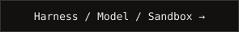
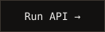
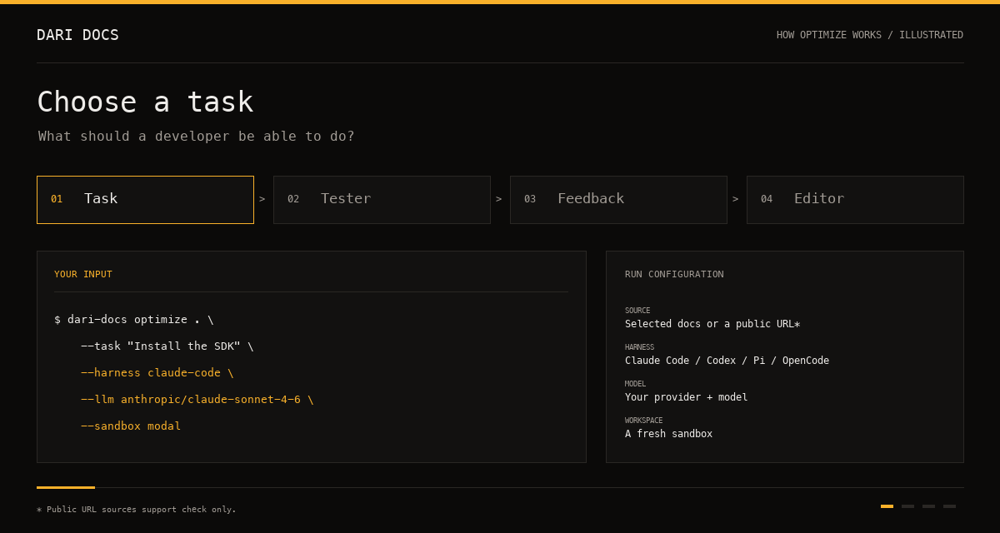

<p align="center">
  
</p>

<h1 align="center">Dari Docs</h1>

<p align="center">
  <b>Find out if your docs work. Then fix what doesn't.</b><br>
  Coding agents try real developer tasks from your docs and propose targeted edits.<br>
  Pick the harness, model, and sandbox. Run on your own keys.
</p>

<p align="center">
  <a href="#get-started"></a>
  <a href="docs/agent-customization.md"></a>
  <a href="docs/self-managed.md#async-runs"></a>
</p>

<p align="center">
  <a href="https://github.com/mupt-ai/dari-docs/actions/workflows/pr-checks.yml"></a>
  <a href="https://github.com/mupt-ai/dari-docs/releases"></a>
  <a href="https://docs.harborframework.com"></a>
</p>

<p align="center">
  <a href="#how-it-works">
    
  </a>
  <br>
  <sub>Illustrated optimize workflow. Runner setup is required; outputs shown are examples.</sub>
</p>

A quickstart can look right and still fail at the first import. `dari-docs` has an agent **actually try the task**, report the blockers, and hand the findings to an editor. You get feedback and complete proposed files—not a docs-quality score or an automatic merge.

## How it works

| Step | What happens | What you get |
| --- | --- | --- |
| **Test** | A tester reads selected local docs or public URLs and attempts your task in a fresh sandbox. | What it tried, what worked, and where it got stuck. |
| **Learn** | Run multiple tasks and model settings, with configurable parallelism. | Individual reports and `aggregate-feedback.md`. |
| **Improve** | `optimize` sends aggregate feedback and the original docs to an editor. | Proposed files in `.dari-docs/updated/`, plus a changelog. |

Built on [Harbor](https://docs.harborframework.com). Claude Code, Codex, Pi, and OpenCode have built-in Harbor adapters. The bundled deployment uses Modal; other Harbor sandboxes and custom adapters are configurable. **Compatibility depends on the harness/model/sandbox combination**—not every pairing works. Other sandbox providers may need extra dependencies and credentials. [See configuration →](docs/agent-customization.md)

## Get started

**Self-deployed, not a hosted service.** You'll need [`uv`](https://docs.astral.sh/uv/getting-started/installation/) (for `uvx`), Python 3.13+, a Modal account, and a model-provider key. The default is Claude Code + `anthropic/claude-sonnet-4-6` + Modal. Model and sandbox usage are billed to your accounts. A **harness** is the agent CLI (such as Claude Code); the **runner** starts it in an isolated **sandbox**.

> [!NOTE]
> **The Harbor runner is not in the latest published release (v0.1.6).** Build this checkout with Go (use the version in `go.mod`) to follow these instructions. The release installer still installs the older runtime.

### 1. Install and initialize

Clone this repository and build the CLI. While this PR is unmerged, check out its `avyay/harbor-runtime` branch first:

```bash
git clone https://github.com/mupt-ai/dari-docs.git
cd dari-docs
git checkout avyay/harbor-runtime
go build -o ./bin/dari-docs ./cmd/dari-docs
export PATH="$PWD/bin:$PATH"
```

From a separate repository containing the documentation you want to test:

```bash
dari-docs init
```

This extracts the editable runner, prompts, skills, and Modal deployment into `.dari-docs/agents/`.

### 2. Deploy your runner

Configure the default Anthropic provider and an authentication token, then deploy:

```bash
export ANTHROPIC_API_KEY="your-anthropic-api-key"
export DARI_DOCS_RUNNER_TOKEN="$(python3 -c 'import secrets; print(secrets.token_urlsafe(32))')"

uvx modal setup
uvx modal secret create dari-docs-model-providers \
  ANTHROPIC_API_KEY="$ANTHROPIC_API_KEY" \
  DARI_DOCS_RUNNER_TOKEN="$DARI_DOCS_RUNNER_TOKEN"
uvx modal deploy .dari-docs/agents/modal_app.py
```

Modal prints **tester** and **editor** HTTPS URLs. Keep `DARI_DOCS_RUNNER_TOKEN` exported in the shell running the CLI. Add other model-provider keys to the deployment secret when you select another provider; do not pass them in docs or `--agent-env`. For existing secrets, token rotation, or non-Modal deployments, follow the [deployment guide](docs/self-managed.md).

### 3. Try a task

Replace the URL placeholders with the ones Modal printed. `check` needs only the tester:

```bash
dari-docs check . \
  --tester-url <tester-url-from-modal> \
  --task "Install the SDK and make a first API call"
```

To test **and propose fixes**, use both URLs:

```bash
dari-docs optimize . \
  --tester-url <tester-url-from-modal> \
  --editor-url <editor-url-from-modal> \
  --task "Install the SDK and make a first API call" \
  --harness claude-code \
  --llm anthropic/claude-sonnet-4-6 \
  --sandbox modal
```

Review `.dari-docs/aggregate-feedback.md` and `.dari-docs/updated/`. Your source docs stay untouched unless you pass `--apply`. Without `--live-verify` and product credentials, the tester can inspect the docs and try safe no-credential steps, then report authentication blockers rather than make authenticated API calls.

## Pick the harness, model, and sandbox

Use the same harness/model for both stages, or give the editor its own setting:

```bash
dari-docs optimize . \
  --tester-url <tester-url-from-modal> \
  --editor-url <editor-url-from-modal> \
  --task "Install the SDK and make a first API call" \
  --harness codex \
  --llm openai/gpt-5.5 \
  --editor-harness claude-code \
  --editor-llm anthropic/claude-sonnet-4-6 \
  --sandbox modal
```

This example needs OpenAI and Anthropic credentials in your deployment. Harness names include `claude-code`, `codex`, `pi`, and `opencode`. `--agent-kwarg KEY=VALUE` and `--sandbox-kwarg KEY=VALUE` pass adapter-specific options. `--agent-env NAME=VALUE` is for non-secret settings. Custom `module:Class` adapters must be installed and allowlisted by the runner operator.

`--harness` and `--llm` apply to both stages unless overridden. `--feedback-llm` overrides the tester model; `--editor-harness` / `--editor-llm` override the editor. `--sandbox` applies to both. For local Docker or other cloud sandboxes, configure the corresponding Harbor adapter on the runner host. [Full configuration →](docs/agent-customization.md)

## More ways to run

### Check published docs

No local checkout needed. Public URLs, including `llms.txt` manifests, support **`check` only** and require internet access:

```bash
dari-docs check \
  --tester-url <tester-url-from-modal> \
  --docs-url https://docs.example.com/llms.txt \
  --task "Create a browser session"
```

### Batch tasks and compare models

Repeat `--task`, or use `--tasks-file` with one task per paragraph or bullet. This runs two tasks against two models on Claude Code:

```bash
dari-docs check . \
  --tester-url <tester-url-from-modal> \
  --parallel 4 \
  --feedback-llm anthropic/claude-sonnet-4-6 \
  --feedback-llm anthropic/claude-opus-4-8 \
  --task "Install the SDK" \
  --task "Configure retries"
```

Pick models your selected harness supports; different harnesses require separate CLI invocations. [Batching and timeout details →](docs/tasks.md)

### Start runs programmatically

The runner exposes async submit, status, lifecycle events, results, and cancellation. This example submits a tester run to your deployed tester URL:

```bash
curl -X POST "$TESTER_URL/runs" \
  -H "Authorization: Bearer $DARI_DOCS_RUNNER_TOKEN" \
  -H "Content-Type: application/json" \
  -d '{"workflow":"test","payload":{"task":"Install the SDK","publicDocUrls":["https://docs.example.com"],"execution":{"harness":"claude-code","sandbox":"modal"}}}'
```

Set `TESTER_URL` to the Modal tester URL first. Poll the returned `statusUrl`, `eventsUrl`, and `resultUrl` **relative to that URL**, using the same authorization header. Events are lifecycle markers, not live token or tool logs. [Run API reference →](docs/self-managed.md#async-runs)

## Outputs and safety

- **Review before applying.** `--apply` overwrites matching repo-relative files and creates new ones; it doesn't delete files. Each optimize run replaces `.dari-docs/updated/`; use `--out` to keep runs separate.
- **Choose what you send.** Defaults include Markdown and docs-adjacent formats such as JSON, YAML, TOML, JavaScript, and TypeScript—not a full source checkout. Common generated directories and files over 5 MB are skipped. `--bundle-include` / `--bundle-exclude` control local inputs; committed secrets in matching files can be included. [Bundle rules →](docs/bundle-selection.md)
- **Live verification is opt-in.** Product credentials use `--live-verify --secret-env NAME`. Prefer test-mode/read-only credentials; the agent can use them in shell commands. [Credential handling →](docs/live-verification.md)
- **Deploy for trusted operators.** The runner token grants use of your provider accounts and access to run results—not tenant isolation. Use spend-limited model keys. Modal results remain in its shared state store until expiry after 30 days of inactivity; there's no per-result delete endpoint. [Trust and retention →](docs/self-managed.md#trust-model)
- **Completion isn't a docs-quality gate.** A successful `check` means workflows completed, not that the docs passed. Add your own report policy if CI must block on feedback. [GitHub Actions →](docs/github-actions.md)
- **Reinitialization overwrites runner code/config.** `init` preserves existing prompts/skills but rewrites runner templates and config. Pass URLs again when reinitializing; old Flue deployments require reinitialization and redeployment. [Migration guide →](docs/self-managed.md#upgrading-from-the-flue-runtime)

## Documentation

[Deployment](docs/self-managed.md) · [Harnesses, models & sandboxes](docs/agent-customization.md) · [Tasks & batching](docs/tasks.md) · [GitHub Actions](docs/github-actions.md) · [Local development](docs/local-development.md)
